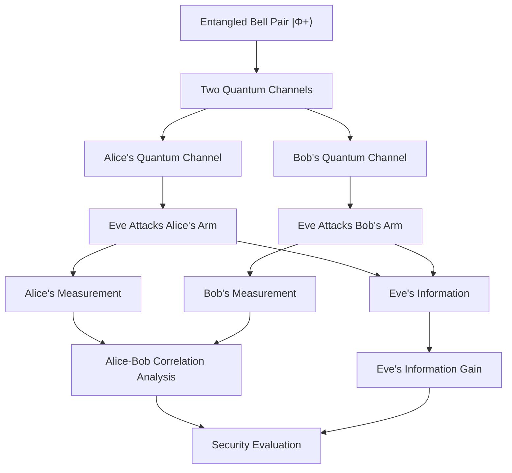
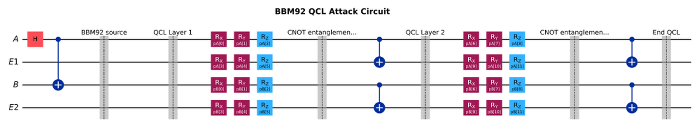
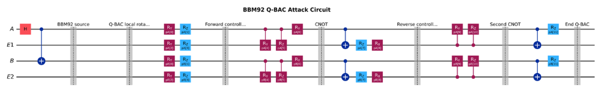
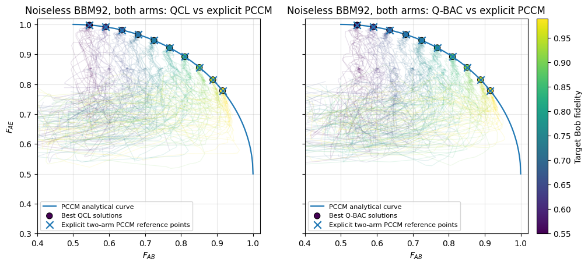
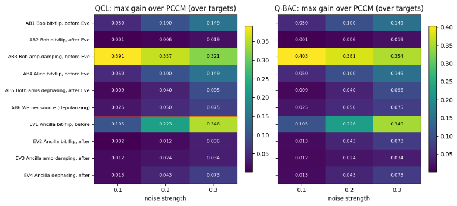
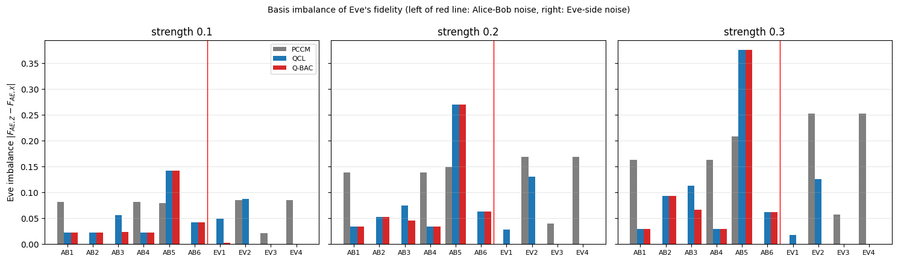
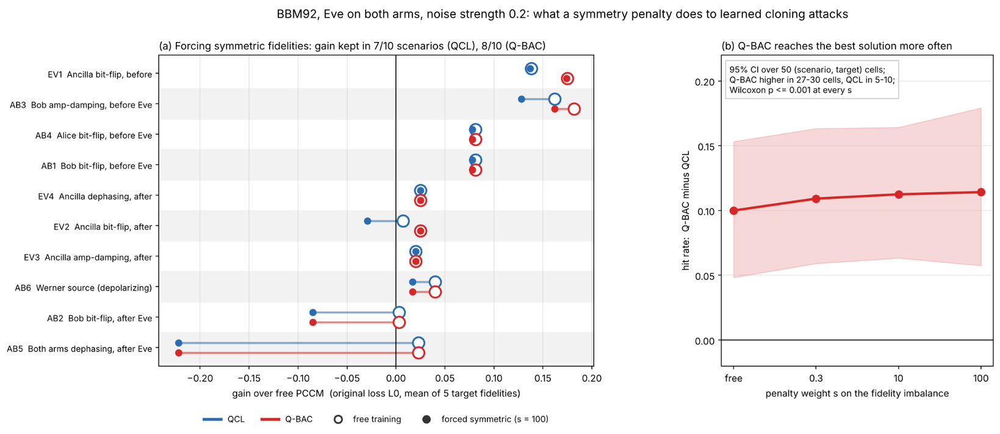
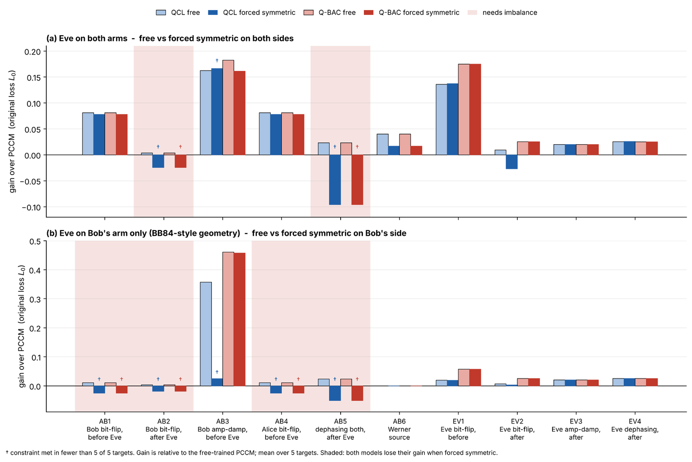
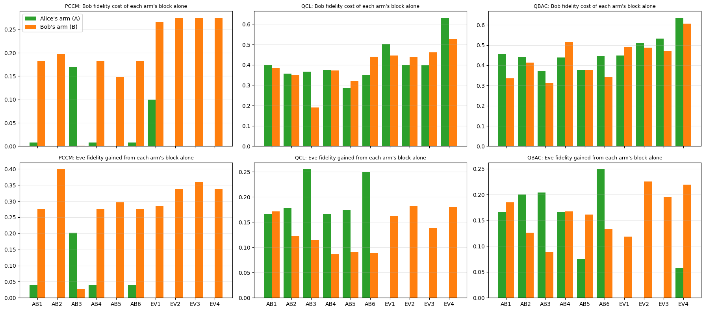

# Entanglement-Based BBM92 Quantum Key Distribution: Comparative Analysis of Eavesdropping Attacks

A quantum simulation-based research project investigating and comparing different individual eavesdropping attacks in the entanglement-based BBM92 Quantum Key Distribution (QKD) protocol.

The project focuses on **two-arm eavesdropping**, where Eve attacks both quantum channels connecting the entangled-pair source to Alice and Bob. It explores the impact of these attacks on quantum correlations, information leakage, and the security of the shared key.

## 📌 Project Overview

BBM92 is an entanglement-based Quantum Key Distribution protocol in which Alice and Bob receive two particles from a shared entangled pair. They independently measure their particles using randomly selected Z and X bases to establish correlated measurement outcomes and generate a shared secret key.

This project investigates how an eavesdropper (Eve) can interact with both particles of the entangled pair to gain information about the quantum states.

Unlike approaches that consider attacks on only one side, this research investigates **both arms of the BBM92 protocol**:

- **Alice's arm:** Eve attacks the quantum channel carrying the particle toward Alice.
- **Bob's arm:** Eve attacks the quantum channel carrying the particle toward Bob.

The project compares different attack architectures to understand how interactions with both quantum channels affect Alice–Bob correlations and Eve's information gain.

## 🎯 Research Objectives

- Investigate individual eavesdropping attacks on both arms of the entangled BBM92 protocol.
- Compare conventional and learnable quantum cloning architectures.
- Evaluate the trade-off between preserving Alice–Bob information and increasing Eve's information gain.
- Analyze the effect of eavesdropping on entanglement and quantum correlations.
- Examine Z- and X-basis measurement outcomes and their impact on protocol security.
- Investigate whether learnable attack architectures can improve Eve's information gain under different noise conditions.

## 🔬 BBM92 and Two-Arm Eavesdropping Architecture

The simulation starts with an entangled Bell state:

$$
|\Phi^+\rangle_{AB} = \frac{|00\rangle + |11\rangle}{\sqrt{2}}
$$

The two particles are distributed through separate quantum channels toward Alice and Bob.

Eve interacts with both channels, targeting the particles travelling toward Alice and Bob.

### Attack Workflow

## ⚛️ Eavesdropping Architectures

This project investigates three quantum attack architectures.

### 1. Phase-Covariant Cloning Machine (PCCM)

PCCM is used as a reference cloning architecture for evaluating the performance of the learnable quantum attack models.

### 2. Quantum Circuit Learning (QCL)

QCL uses a trainable quantum circuit with rotation gates and entangling operations.

The circuit includes:

- RX, RY, and RZ rotation gates.
- CNOT gates for entangling operations.
- Trainable circuit parameters.

  

### 3. Quantum-Based Attack Circuit (Q-BAC)

Q-BAC is a proposed learnable quantum attack architecture designed to investigate whether trainable quantum circuits can improve Eve's information gain.

The architecture uses:

- RY and RZ rotation gates.
- Controlled-RY (CRY) and Controlled-RZ (CRZ) gates.
- RX rotation gates.
- CNOT gates for entangling operations.

The performance of Q-BAC is compared with PCCM and QCL under different experimental conditions.

  

## 📊 Evaluation Metrics

The attack architectures are evaluated using the following measurements:

| Metric                         | Purpose                                                                  |
| ------------------------------ | ------------------------------------------------------------------------ |
| Alice–Bob Fidelity ((F\_{AB})) | Measures how well Bob preserves Alice's quantum information.             |
| Alice–Eve Fidelity ((F\_{AE})) | Measures how accurately Eve can obtain Alice's quantum information.      |
| QBER                           | Measures the quantum bit error rate between Alice and Bob.               |
| Z-basis Fidelity               | Evaluates performance in the Z measurement basis.                        |
| X-basis Fidelity               | Evaluates performance in the X measurement basis.                        |
| Basis Correlation              | Examines the correlation between Alice's and Bob's measurement outcomes. |
| Marginal Bias                  | Measures unwanted bias in measurement outcomes.                          |

The main objective is to study the relationship between Alice–Bob information preservation and Eve's information gain.

## ⚙️ Optimization Methodology

Numerical optimization is used to train the learnable attack architectures.

The initial optimization objective is:

$$
\mathcal{L}_0 =
10(F_{AB}-f_{\text{target}})^2-F_{AE}
$$

A marginal-bias penalty is added to the objective:

$$
\mathcal{L} =
\mathcal{L}_0+1000P_{\text{bias}}
$$

Where:

- $F_{AB}$ = Alice–Bob fidelity.
- $F_{AE}$ = Alice–Eve fidelity.
- $f_{\text{target}}$ = Target Alice–Bob fidelity.
- $P_{\text{bias}}$ = Marginal-bias penalty.

The optimization aims to:

1. Keep Alice–Bob fidelity close to the selected target.
2. Maximize Eve's information gain.
3. Reduce unwanted measurement bias.

## 🧪 Noise Scenarios

10 scenarios × 3 strengths (0.1 / 0.2 / 0.3) = **30 noise conditions**.

| ID | System | Noise / Attack Scenario |
|---|---|---|
| AB1 | Alice–Bob | Bob bit-flip, before Eve |
| AB2 | Alice–Bob | Bob bit-flip, after Eve |
| AB3 | Alice–Bob | Bob amplitude damping, before Eve |
| AB4 | Alice–Bob | Alice bit-flip, before Eve |
| AB5 | Alice–Bob | Both arms dephasing, after Eve |
| AB6 | Alice–Bob | Werner source (depolarizing) |
| EV1 | Eve | Ancilla bit-flip, before |
| EV2 | Eve | Ancilla bit-flip, after |
| EV3 | Eve | Ancilla amplitude damping, after |
| EV4 | Eve | Ancilla dephasing, after |

---

## 📊 Results

### Q1 · Noiseless: QCL and Q-BAC land exactly on PCCM

  

- **10 / 10** target fidelities where QCL and Q-BAC match PCCM.
- **5.6 × 10⁻¹⁶** maximum loss gap between PCCM and the Fuchs–Peres bound.
- No gain without noise, as in the mother paper, so the setup is validated.

### Q2 · Under noise, both learned attacks beat PCCM

  

*Max gain over PCCM (over 5 target fidelities), 10 noise scenarios × 3 strengths.*

- Gain in **all 30** noise conditions.
- Largest gain: **AB3** (Bob amplitude damping before Eve), Q-BAC **0.403** and QCL **0.391** at strength 0.1.
- Q-BAC is ahead of QCL in **AB3, EV1 and EV2**.
- Against PCCM with the same trained readout, the gain barely changes, so the advantage comes from the circuit, not the readout.

### Eve's Z/X fidelity imbalance

  

- **AB5** is where the learned circuits are clearly more imbalanced than PCCM (up to about 0.37 at strength 0.3).
- In **AB1, AB4 and EV4** the learned circuits are *less* imbalanced than PCCM yet still gain, so more imbalance is not the whole story.

### Q3 · Q-BAC vs QCL: same ceiling, better reliability

  

- **Gain:** identical in 7 of 10 scenarios; Q-BAC leads in AB3, EV1 and EV2. Over 50 (scenario, target) rows: **14 wins, 35 ties, 1 loss**; mean difference **+0.007** (95% CI 0.003 to 0.013).
- **Reliability:** share of random restarts that reach the best loss is **0.41 for Q-BAC vs 0.31 for QCL**. Q-BAC's hit rate is higher in 27–30 of 30 cells at every penalty weight (Wilcoxon p ≤ 0.001).

### Q4 · Where does the gain come from? Imbalance, plus the second arm

  

- **Bob-only control (BB84-equivalent):** the gain in AB1, AB2, AB4 and AB5 vanishes under forced symmetry, reproducing the mother paper's mechanism.
- **Two arms:** the gain survives in **8 of 10** scenarios (Q-BAC); only AB2 and AB5 collapse.
- Adding the second arm raises the gain by **+0.07** (AB1, AB4), **+0.04** (AB6) and **+0.12** (EV1).

### Which arm does the work?

  

- Green = Alice's arm (A); orange = Bob's arm (B).
- Top row: Bob's fidelity cost of each arm's block alone. Bottom row: Eve's fidelity gained from each arm's block alone.
- PCCM relies almost entirely on Bob's arm, while **QCL and Q-BAC use both arms**.

### Q5 · Symmetry penalty: why we add it and what it shows

- **Why:** if the gain were only imbalance, removing the imbalance must kill it. The penalty is the intervention that tests this.
- Bob-side imbalance is what Alice and Bob can check, so penalizing it is physically meaningful.
- Penalized PCCM cannot meet the constraint; the learned attacks beat it by **0.13 to 0.68**.

---

##  Contributions

1. Extension of QCL-style attacks to an entanglement-based protocol with Eve on both arms, validated against Fuchs–Peres and PCCM.
2. A 30-condition noise benchmark including Eve-side noise, with ceiling checks (arm-local vs joint).
3. A causal test of the gain mechanism: it is partly imbalance, as in the mother paper, but survives forced symmetry in 8 of 10 two-arm scenarios.
4. Q-BAC does not raise the ceiling; it is the more reliable optimizer and retains more gain under symmetry (**96% vs 87%**).

---
