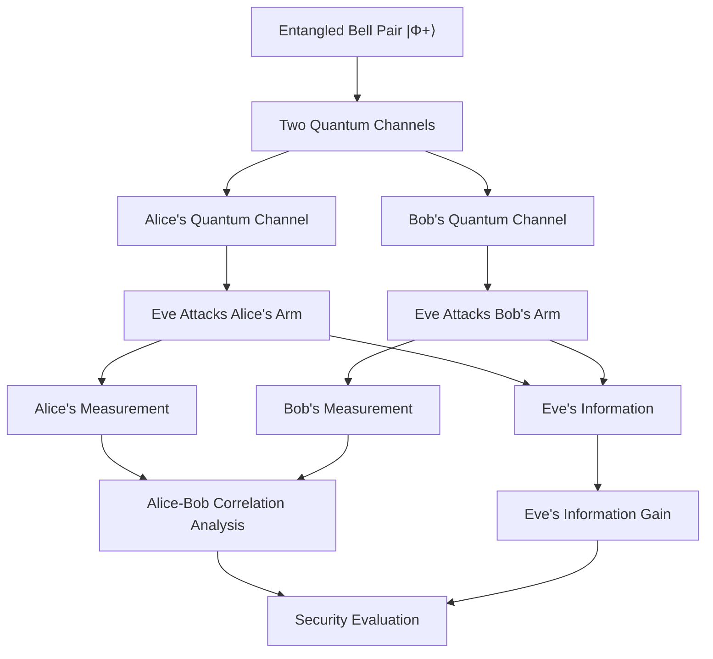

# Entanglement-Based BBM92 Quantum Key Distribution: Comparative Analysis of Eavesdropping Attacks

A quantum simulation-based research project investigating and comparing different individual eavesdropping attacks in the entanglement-based BBM92 Quantum Key Distribution (QKD) protocol.

The project focuses on **two-arm eavesdropping**, where Eve attacks both quantum channels connecting the entangled-pair source to Alice and Bob. It explores the impact of these attacks on quantum correlations, information leakage, and the security of the shared key.

## 📌 Project Overview

BBM92 is an entanglement-based Quantum Key Distribution protocol in which Alice and Bob receive two particles from a shared entangled pair. They independently measure their particles using randomly selected Z and X bases to establish correlated measurement outcomes and generate a shared secret key.

This project investigates how an eavesdropper (Eve) can interact with both particles of the entangled pair to gain information about the quantum states.

Unlike approaches that consider attacks on only one side, this research investigates **both arms of the BBM92 protocol**:

- **Alice's arm:** Eve attacks the quantum channel carrying the particle toward Alice.
- **Bob's arm:** Eve attacks the quantum channel carrying the particle toward Bob.

The project compares different attack architectures to understand how interactions with both quantum channels affect Alice–Bob correlations and Eve's information gain.

## 🎯 Research Objectives

- Investigate individual eavesdropping attacks on both arms of the entangled BBM92 protocol.
- Compare conventional and learnable quantum cloning architectures.
- Evaluate the trade-off between preserving Alice–Bob information and increasing Eve's information gain.
- Analyze the effect of eavesdropping on entanglement and quantum correlations.
- Examine Z- and X-basis measurement outcomes and their impact on protocol security.
- Investigate whether learnable attack architectures can improve Eve's information gain under different noise conditions.

## 🔬 BBM92 and Two-Arm Eavesdropping Architecture

The simulation starts with an entangled Bell state:

$$
|\Phi^+\rangle_{AB} = \frac{|00\rangle + |11\rangle}{\sqrt{2}}
$$

The two particles are distributed through separate quantum channels toward Alice and Bob.

Eve interacts with both channels, targeting the particles travelling toward Alice and Bob.

### Attack Workflow

## ⚛️ Eavesdropping Architectures

This project investigates three quantum attack architectures.

### 1. Phase-Covariant Cloning Machine (PCCM)

PCCM is used as a reference cloning architecture for evaluating the performance of the learnable quantum attack models.

### 2. Quantum Circuit Learning (QCL)

QCL uses a trainable quantum circuit with rotation gates and entangling operations.

The circuit includes:

- RX, RY, and RZ rotation gates.
- CNOT gates for entangling operations.
- Trainable circuit parameters.

  

### 3. Quantum-Based Attack Circuit (Q-BAC)

Q-BAC is a proposed learnable quantum attack architecture designed to investigate whether trainable quantum circuits can improve Eve's information gain.

The architecture uses:

- RY and RZ rotation gates.
- Controlled-RY (CRY) and Controlled-RZ (CRZ) gates.
- RX rotation gates.
- CNOT gates for entangling operations.

The performance of Q-BAC is compared with PCCM and QCL under different experimental conditions.

  

## 📊 Evaluation Metrics

The attack architectures are evaluated using the following measurements:

| Metric                         | Purpose                                                                  |
| ------------------------------ | ------------------------------------------------------------------------ |
| Alice–Bob Fidelity ((F\_{AB})) | Measures how well Bob preserves Alice's quantum information.             |
| Alice–Eve Fidelity ((F\_{AE})) | Measures how accurately Eve can obtain Alice's quantum information.      |
| QBER                           | Measures the quantum bit error rate between Alice and Bob.               |
| Z-basis Fidelity               | Evaluates performance in the Z measurement basis.                        |
| X-basis Fidelity               | Evaluates performance in the X measurement basis.                        |
| Basis Correlation              | Examines the correlation between Alice's and Bob's measurement outcomes. |
| Marginal Bias                  | Measures unwanted bias in measurement outcomes.                          |

The main objective is to study the relationship between Alice–Bob information preservation and Eve's information gain.

## ⚙️ Optimization Methodology

Numerical optimization is used to train the learnable attack architectures.

The initial optimization objective is:

$$
\mathcal{L}_0 =
10(F_{AB}-f_{\text{target}})^2-F_{AE}
$$

A marginal-bias penalty is added to the objective:

$$
\mathcal{L} =
\mathcal{L}_0+1000P_{\text{bias}}
$$

Where:

- $F_{AB}$ = Alice–Bob fidelity.
- $F_{AE}$ = Alice–Eve fidelity.
- $f_{\text{target}}$ = Target Alice–Bob fidelity.
- $P_{\text{bias}}$ = Marginal-bias penalty.

The optimization aims to:

1. Keep Alice–Bob fidelity close to the selected target.
2. Maximize Eve's information gain.
3. Reduce unwanted measurement bias.

## 🧪 Experimental Settings

The project investigates different attack configurations under ideal and noisy simulation conditions.

### Ideal Experiments

- Noise-free quantum circuit simulations.
- Entangled Bell-state initialization.
- Z- and X-basis measurements.
- Comparative evaluation of PCCM, QCL, and Q-BAC.

### Noisy Experiments

- Density-matrix-based simulation.
- Investigation of different attack scenarios.
- Evaluation under different noise conditions.
- Comparison of two-arm attacks with a Bob-only attack control.

These experiments help investigate how noise and access to both quantum channels influence the information–disturbance trade-off.

## 🛠️ Technologies Used

- **Python** – Main programming language.
- **NumPy** – Numerical operations and validation.
- **SciPy** – Numerical optimization.
- **Pandas** – Experimental data handling and analysis.

## 🔍 Research Scope

The main research question is whether learnable quantum attack architectures can provide an advantage over established cloning approaches when Eve has access to both arms of an entangled BBM92 system.

The study evaluates the performance of Q-BAC and QCL against PCCM across different attack configurations and noise conditions.

The results are analyzed comparatively, without assuming that a learnable architecture is universally superior to the reference benchmark.

